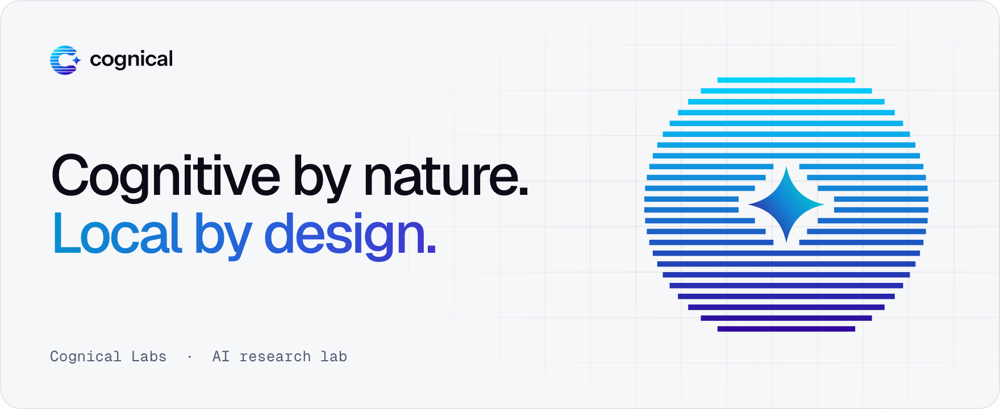

<picture>
  <source media="(prefers-color-scheme: dark)" srcset="banner-dark.png">
  
</picture>

  <a href="https://cognical.si">cognical.si</a>&nbsp;&nbsp;·&nbsp;&nbsp;<a href="mailto:hello@cognical.si">hello@cognical.si</a>

### Superintelligence should be local.

Cognical Labs researches efficient models and applications that bring increasingly capable intelligence to the devices you own. Private by design. Under your control.

<picture>
  <source media="(prefers-color-scheme: dark)" srcset="belief-dark.png">
  
</picture>

### Local is the future. Help us build it.

Researchers, engineers and device makers who share the belief, we would love to hear from you at [hello@cognical.si](mailto:hello@cognical.si).
